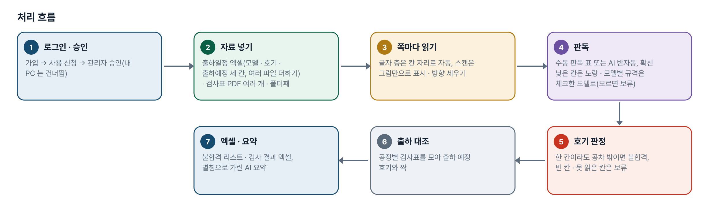
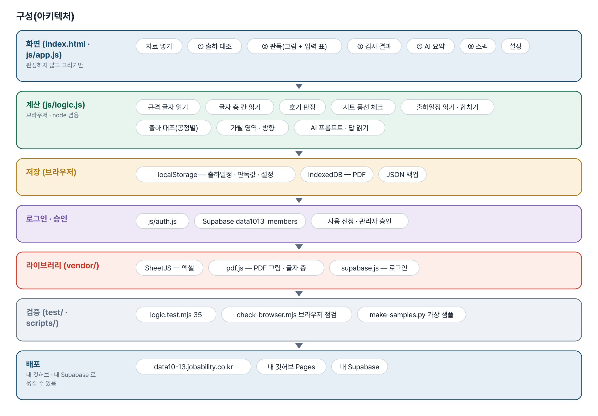
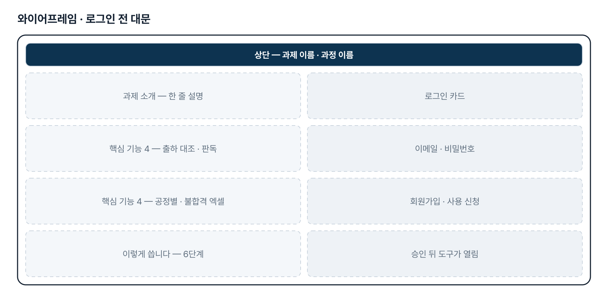
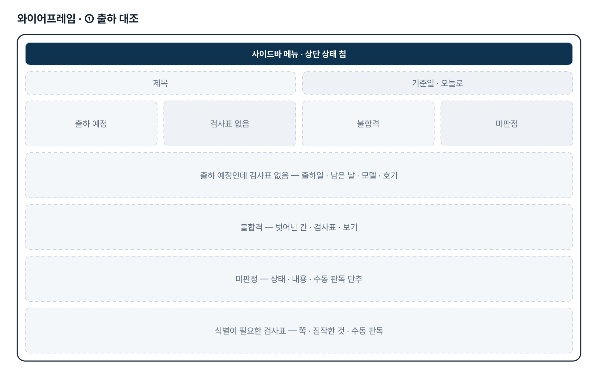
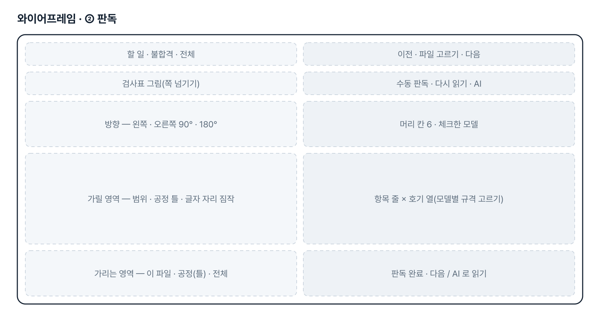
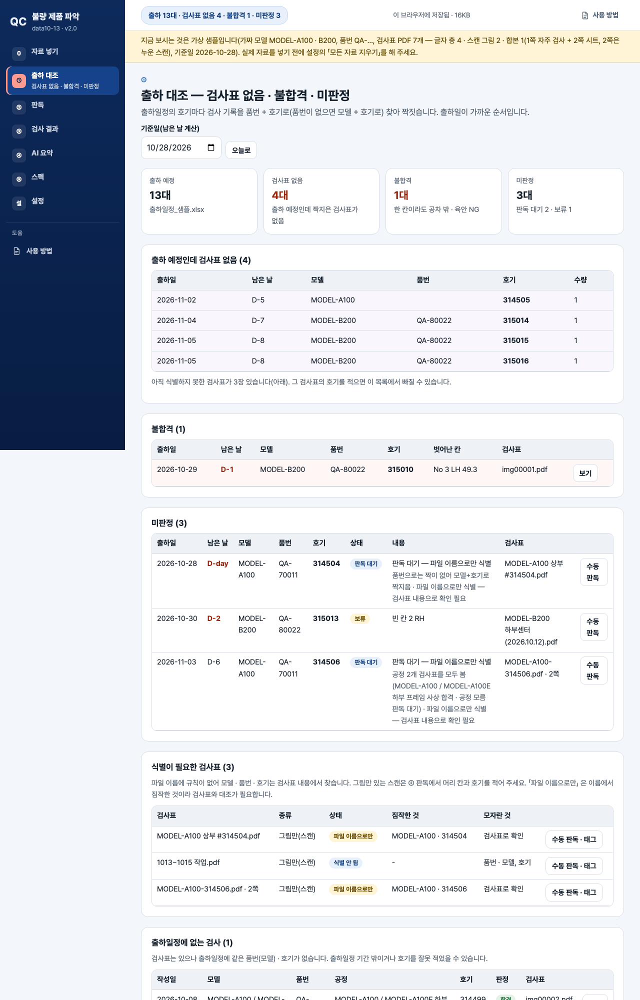

# 불량 제품 파악 — 프로젝트 기획서 v2.4

- 기획: 구민채 · 작성일 2026-11-10 · 현장 데이터 디지털화 전문가과정 · 2차수 프로젝트 13
- 바로 쓰기: https://data10-13.jobability.co.kr/
- 워드 판: `docs/기획서/data10-13_구민채_불량제품파악_기획서_v2.4.docx`

## 개요

공유폴더의 수기 검사표 PDF를 쪽마다 판독해 검사표에 적힌 공차로 호기별 합불을 판정하고, 출하일정과 맞춰 검사표 없음 · 불합격 · 미판정 리스트를 만드는 브라우저 도구입니다.

### 배경 · 현재 업무
- 현장에서 제품 스펙을 출력한 종이 검사표에 손으로 적고, 스캔한 PDF를 공유폴더에 올립니다.
- 검사표 양식은 공정마다 다릅니다(자주 검사 CHECK SHEET · 도장 · 시트 부착 체크시트 등). 측정값 칸에는 실측값이나 OK 를, 시트 체크시트는 모델링 뷰의 풍선에 체크를 합니다.
- 파일 이름 규칙이 없고, 한 PDF 에 같은 모델 여러 호기나 여러 공정이 함께 들어오기도 합니다.
- 출하일정 엑셀(소형 · 초대형 · 버켓 등 파일이 나뉨)과 검사표를 손으로 맞춰 합불 엑셀을 정리하고 있어 누락과 불합격을 놓치기 쉽습니다.

### 목표
- 출하 예정 호기마다 검사표가 있는지, 합격인지를 출하일이 가까운 순서로 보여 줍니다.
- 스캔 검사표를 그림 옆 입력 표로 빠르게 옮기고, 적는 즉시 호기마다 합불을 판정합니다.
- 공정별 검사표를 모두 모아 호기 하나의 판정으로 묶습니다.
- 불합격 리스트와 결과를 엑셀로 내보내 보고에 바로 씁니다.

## 요구사항과 구현

| 기획서 요구 | 구현 |
|---|---|
| 업로드 · 검사 누락 | 출하일정 호기마다 품번 + 호기(없으면 모델 + 호기)로 검사표와 짝 → 검사표 없음 · 미판정 목록, 식별이 필요한 검사표 |
| 불합격 제품 리스트 | 호기 · 칸(No + LH/RH) 단위, 검사표에 적힌 규격으로 판정, 엑셀 8개 시트 |
| 수기 PDF 분석 | 글자 층이 있으면 자동, 스캔은 수동 판독 표 + AI 반자동(그림 받기 · 프롬프트 · 답 붙여 넣기). 브라우저 안 손글씨 자동 인식은 하지 않음 |
| 합불 엑셀 리스트 정리 | 불합격_리스트 · 검사_결과 · 측정값_전체 · 출하_대조 등 엑셀 내보내기 |
| 측정값은 실측값 또는 OK, 시트는 풍선 체크(11-10 답 ①) | 수치 칸의 OK 는 합격, 시트 공정은 「부착 확인」 — OK 또는 「체크 수/풍선 수」 |
| 출하일정 파일 여러 개 · 초대형 형식(11-10 답 ③) | 「출하예정」 · 두 줄 머리 · 연도 없는 「월/일」 읽기, 파일 더하기, 모델 이름이 조금 달라도 같은 호기 짝 · 4차부터 모델 · 호기 · 출하예정 세 칸만 읽음 |
| 한 PDF 에 여러 호기 · 여러 공정(11-10 답 ④) | 쪽마다 검사표 한 장, 같은 호기의 공정별 검사표를 모두 보고 판정 |
| PDF 마다 가릴 위치 따로(추가 요청) | 이 파일 · 쪽만 > 공정 기본(직접 그린 것 > 공정 틀) > 모든 검사표 기본 세 겹 |
| 판독 대기 · 보류에 수동 판독 단추(추가 요청) | 출하 대조 · 결과 · 판독 화면의 「수동 판독」 — 그 쪽을 열고 첫 빈 칸에 커서 |
| 90° · 180° 돌아간 PDF(추가 요청) | 쪽마다 돌리기 단추, AI 그림도 그 방향. 글자 층 쪽은 자동, 스캔은 수동 |
| 가릴 영역 틀 2가지(11-10 4차 ②) | ① 제작 · 가공형 4칸(가공 · 평행도 · ASSY 양식, 도장은 확인란 · 검사자 2칸) · ② 상단 결재란 1칸형(시트 · 각장 · 비용접). 공정명으로 자동, 설정 · 판독 화면에서 바꿈. 글자 층 쪽은 「입안 · 심사 · 결정」 · 「검사자」 · 「확인」 낱말 자리로 짐작, 스캔 쪽은 틀 + 쪽마다 미세 조정 |
| 출하일정 세 칸만(11-10 4차 ③) | 소형 · 대형 · 초대형 어느 파일이든 모델 · 호기 · 출하예정만 찾아 씀. 상부 · 하부 · Line · 품번 · 수량은 읽지도 알리지도 않음(끄면 예전처럼 품번도 읽음) |
| 한 칸에 모델별 규격 둘(11-10 4차 ④) | 모델명 칸의 체크(✓ · V · ○ · ■)로 모델을 알아내 그 규격 적용. 체크를 못 읽거나 규격이 하나로 안 모이면 그 칸 보류 → 판독 화면에서 체크한 모델 · 항목 규격을 고름. AI 답의 「체크모델」 도 같은 칸 |
| 스캔 PDF 는 사람이 나눠 저장(11-10 4차 ①) | 코드 변경 없음 — 한 PDF 의 쪽마다 검사표로 따로 판독하므로 나누지 않고 넣어도 됨(나눠도 됨) |
| 공유폴더 자동 점검 · 알림 | 2단계 — 지금은 PDF 를 넣어서 점검 |

## 주요 기능

- **출하 대조** — 출하 예정 호기마다 검사표 없음 · 불합격 · 미판정을 출하일 순으로 남은 날(D-n)과 함께 보여 줍니다.
- **검사표 판독** — 검사표 그림 옆 표에 값을 적으면 바로 칸 색과 호기 판정이 나옵니다. 수동 판독 · AI 반자동.
- **공정별 · 여러 쪽 검사표** — 한 PDF 의 쪽마다 따로 판독하고, 같은 호기의 공정별 검사표를 모두 모아 판정합니다.
- **불합격 리스트 · 엑셀** — 호기 · 칸 · 기준 · 적힌 값 · 문제점을 모아 엑셀 8개 시트로 내보냅니다.
- **규격 읽기** — 「420±1」 「48 +1.0/-0.5」 「1.5 MAX」 「80㎛↑」 같은 검사표 글자에서 하한 · 상한을 읽습니다. 덮어쓰기 표는 선택. 한 칸에 모델별 규격이 둘이면 체크한 모델의 규격으로, 모르면 보류합니다.
- **시트 풍선 체크** — 시트 부착 체크시트는 OK 또는 「체크 수/풍선 수」로 판정합니다. 모자라면 불합격.
- **방향 · 가릴 영역** — 돌아간 쪽을 바로 세우고, 결재 칸 · 검사자 · 확인란을 공정 틀(① 4칸 · ② 상단 1칸)로 자동으로 가립니다. 파일 · 쪽마다 맞출 수 있습니다.
- **AI 요약 프롬프트** — 계산된 숫자만 담고 품번 · 모델을 별칭으로 가린 보고용 프롬프트를 만듭니다.
- **로그인 · 사용 승인** — 회사 메일이나 개인 메일로 가입해 사용 신청, 관리자가 승인하면 도구가 열립니다.

## 처리 흐름(파이프라인)

1. **로그인 · 승인** — 가입 → 사용 신청 → 관리자 승인(내 PC 는 건너뜀)
2. **자료 넣기** — 출하일정 엑셀(모델 · 호기 · 출하예정 세 칸, 여러 파일 더하기) · 검사표 PDF 여러 개 · 폴더째
3. **쪽마다 읽기** — 글자 층은 칸 자리로 자동, 스캔은 그림만으로 표시 · 방향 세우기
4. **판독** — 수동 판독 표 또는 AI 반자동, 확신 낮은 칸은 노랑 · 모델별 규격은 체크한 모델로(모르면 보류)
5. **호기 판정** — 한 칸이라도 공차 밖이면 불합격, 빈 칸 · 못 읽은 칸은 보류
6. **출하 대조** — 공정별 검사표를 모아 출하 예정 호기와 짝
7. **엑셀 · 요약** — 불합격 리스트 · 검사 결과 엑셀, 별칭으로 가린 AI 요약

## 구성(아키텍처)

- **화면 (index.html · js/app.js)** — 자료 넣기 · ① 출하 대조 · ② 판독(그림 + 입력 표) · ③ 검사 결과 · ④ AI 요약 · ⑤ 스펙 · 설정
- **계산 (js/logic.js)** — 규격 글자 읽기 · 글자 층 칸 읽기 · 호기 판정 · 시트 풍선 체크 · 출하일정 읽기 · 합치기 · 출하 대조(공정별) · 가릴 영역 · 방향 · AI 프롬프트 · 답 읽기
- **저장 (브라우저)** — localStorage — 출하일정 · 판독값 · 설정 · IndexedDB — PDF · JSON 백업
- **로그인 · 승인** — js/auth.js · Supabase data1013_members · 사용 신청 · 관리자 승인
- **라이브러리 (vendor/)** — SheetJS — 엑셀 · pdf.js — PDF 그림 · 글자 층 · supabase.js — 로그인
- **검증 (test/ · scripts/)** — logic.test.mjs 35 · check-browser.mjs 브라우저 점검 · make-samples.py 가상 샘플
- **배포** — data10-13.jobability.co.kr · 내 깃허브 Pages · 내 Supabase

## 화면 구성(와이어프레임)

## 규칙 · 판정 기준

- 호기마다, 한 칸이라도 하한 · 상한을 벗어나면 불합격입니다(빈 칸이 함께 있어도). 하한 · 상한과 같은 값은 합격(설정에서 바꿈).
- 측정값 칸의 OK 는 합격, NG 는 불합격입니다. 값 없이 체크(V)만 한 칸은 설정(기본 합격)을 따릅니다.
- 시트 부착 확인은 OK 또는 「체크 수/풍선 수」로 적고, 체크가 하나라도 모자라면 불합격입니다.
- 빈 칸 · 못 읽은 칸(「?」) · 규격을 못 읽은 항목은 보류(미판정)입니다.
- 출하일정 호기와는 품번 + 호기로 먼저, 없으면 모델 + 호기로 짝짓습니다. 모델 이름 뒤에 글자가 조금 붙은 경우도 같은 호기면 짝짓고 알립니다.
- 같은 호기의 공정별 검사표는 모두 봅니다. 하나라도 불합격이면 불합격, 하나라도 판독 전이면 미판정, 같은 공정은 나중에 판독한 것을 씁니다.
- 가릴 영역은 이 파일 · 쪽만 > 공정 기본(직접 그린 것 > 공정 틀) > 모든 검사표 기본 순서로 정합니다. 공정 틀은 공정명으로 자동으로 고르고 설정에서 바꿉니다.
- 한 칸에 모델별 규격이 둘 이상이면 체크한 모델(사람 · AI 가 고른 것 > 모델명 칸의 체크 > 모델이 하나뿐)의 규격으로 판정하고, 정하지 못하면 그 칸을 보류합니다.
- 출하일정은 모델 · 호기 · 출하예정 세 칸만 읽습니다. 출하예정이 빈 줄은 날짜 없이 넣고 한 줄로만 알립니다.

## 검증

- 계산 규칙 테스트 40개 통과
- 4차에 5개를 더했습니다(가릴 영역 틀 자동 · 겹 순서, 글자 자리 짐작, 출하일정 세 칸 · 소형 · 대형 · 초대형, 체크 표시 읽기 · 모델별 규격 나누기, 체크한 모델 규격 · 보류 · 사람이 고름).
- 일부러 깨뜨려 확인 10가지 — 시트를 ① 틀로, 틀 겹 빼기, 세 칸만 끄기, 이름이 똑같은 칸 우선 빼기, 빈 출하예정 줄마다 알림, 첫 규격만 읽기, 체크 표시 무시, 고른 규격 무시, 검사자 짐작 빼기, 모름이어도 보류 안 함 — 모두 해당 시험이 실패하고 원복했습니다.
- 브라우저 점검(scripts/check-browser.mjs)에 4차 흐름(모델별 규격 보류 → 체크한 모델 · 규격 고르기, 공정 「가공」 틀 자동 · 틀 바꾸기 · 글자 자리 짐작, 설정 공정별 틀, 대형 출하일정 세 칸)을 더해 모두 통과, 360 · 390 · 768 · 1280px 가로 넘침 0 · 콘솔 오류 0.

## 이번 판에서 하지 않는 것

- 업무 자료(출하일정 · 판독값)는 아직 팀 공유 DB 가 아니라 이 브라우저(localStorage · IndexedDB)에 저장합니다. 다른 PC 는 JSON 백업으로 옮깁니다.
- 스캔 그림의 손글씨를 브라우저 안에서 자동으로 읽지 않습니다 — 수동 판독이나 AI 반자동(사람 확인 필수)입니다.
- 스캔 그림의 방향은 자동으로 알 수 없어 단추로 세웁니다(글자 층이 있는 쪽만 자동).
- 공유폴더를 정기적으로 훑거나 알림을 보내지 않습니다.
- 가릴 영역 틀은 보내 주신 사진 위치를 비율로 옮긴 출발점입니다. 스캔 그림에서 결재 칸 위치를 AI 가 스스로 찾지는 않습니다(글자 층이 있는 쪽만 낱말 자리로 짐작) — 어긋난 쪽은 판독 화면에서 그 쪽만 맞춥니다.
- 「모델별 Spec 참조」 처럼 규격이 다른 표에 있는 항목은 지금도 규격 없음(보류)입니다 — 덮어쓰기 표로 넣습니다.

## 다음 단계

- 실제 스캔 PDF 로 공정 틀 위치 · 체크한 모델 읽기 · 쪽 나누기 · 방향 확인
- AI 판독 정확도 재기(지금의 합불 엑셀을 정답으로) · 사내 허용 AI 연결
- 팀 공유 저장(판독값 · 출하일정)과 공유폴더 정기 점검

## 버전 이력

- **v2.4** (2026-11-10) — 4차 요청 반영 — 가릴 영역 틀 2가지(① 제작 · 가공형 4칸 = 결재 위 · 검사자 · 개정 확인란 · 결재 아래, ② 상단 결재란 1칸형 = 시트 · 각장 · 비용접구간), 공정명으로 자동 · 설정에서 바꾸기, 글자 층 쪽은 낱말 자리로 짐작 / 출하일정은 「모델 · 호기 · 출하예정」 세 칸만 읽기(소형 · 대형 · 초대형 모두, 나머지 칸은 무시 · 알림 없음) / 한 칸에 모델별 규격이 둘 — 모델명 칸의 체크 표시로 모델을 알아내 그 규격으로 판정, 모르면 그 칸 보류 · 판독 화면에서 모델이나 규격을 고름 / 판 2026-11-10.8
- **v2.0** (2026-11-10) — 최종 기획서 — 파이프라인 · 아키텍처 · 와이어프레임 정리 / 로그인 · 사용 신청 · 관리자 승인(요청자 Supabase 로 옮길 수 있게) / 로그인 전 대문 / 요청자 답 반영 — 측정값 OK · 시트 풍선 체크, 초대형 출하일정 · 파일 더하기, 한 PDF 여러 쪽 · 공정별 판정 / 추가 요청 반영 — PDF(쪽)별 가릴 영역, 수동 판독 단추, 90° · 180° 돌리기
- **v1.1** (2026-10-28) — 2차 — 자주 검사 CHECK SHEET 양식 · 호기 단위 판정 · 출하일정 대조 · 검사표 내용으로 식별
- **v1.0** (2026-10-21) — 1단계 — 업로드 누락 대조 · 판독 화면 · 합불 판정 · AI 요약 · 스펙 기준표
